<a name="top"></a>

<p align="center">
  <a href="https://github.com/balaji87-z"></a>
</p>

<p align="center">
  
</p>

<p align="center">
  <a href="https://github.com/balaji87-z"></a>
  <a href="https://github.com/balaji87-z?tab=followers"></a>
  <a href="https://github.com/balaji87-z?tab=repositories"></a>
</p>

<p align="center">
  <a href="#whoami"></a>
  <a href="#stack"></a>
  <a href="#projects"></a>
  <a href="#pill"></a>
  <br />
  <a href="#telemetry"></a>
  <a href="#snake"></a>
  <a href="#network"></a>
</p>

<br />

<a name="whoami"></a>


<p align="center">
  
</p>

<br />

<a name="stack"></a>


<p align="center">
  
</p>

<br />

<a name="projects"></a>


<p align="center">
  <a href="https://github.com/balaji87-z/kortex-shield"></a>
</p>

<p align="center">
  <a href="https://github.com/balaji87-z/kortex-shield/commits"></a>
  <a href="https://github.com/balaji87-z/kortex-shield"></a>
  <a href="https://github.com/balaji87-z/kortex-shield"></a>
</p>

<p align="center">
  
  
  
</p>

<br />

<a name="pill"></a>


<details>
<summary></summary>
<br />

> *You stay in Wonderland, and I show you how deep the rabbit hole goes.*

```bash
$ ls ~/rabbit-hole
```

* 🛡️ [kortex-shield](https://github.com/balaji87-z/kortex-shield) — follow the WAF build, step by step
* 📦 [All repositories](https://github.com/balaji87-z?tab=repositories) — everything else in the lab
* ⭐ [Follow](https://github.com/balaji87-z) — get the next transmission

</details>

<details>
<summary></summary>
<br />

> *The story ends. You wake up in your bed and believe whatever you want to believe.*

```bash
$ exit
Connection to the Matrix closed.
```

[⬆ Back to the top](#top)

</details>

<br />

<a name="telemetry"></a>


<p align="center">
  
</p>

<p align="center">
  
  
</p>

<p align="center">
  
</p>

<details>
<summary><b>📈 Open the full profile breakdown</b></summary>
<br />
<p align="center">
  
</p>
<p align="center">
  
  
</p>
</details>

<br />

<a name="snake"></a>


<p align="center">
  <picture>
    <source media="(prefers-color-scheme: dark)" srcset="https://raw.githubusercontent.com/balaji87-z/balaji87-z/output/github-contribution-grid-snake-dark.svg" />
    <source media="(prefers-color-scheme: light)" srcset="https://raw.githubusercontent.com/balaji87-z/balaji87-z/output/github-contribution-grid-snake.svg" />
    
  </picture>
</p>

<br />

<a name="transmission"></a>


<p align="center">
  
</p>

<br />

<a name="network"></a>


<p align="center">
  <a href="https://github.com/balaji87-z"></a>
</p>

<p align="center">
  <a href="https://github.com/balaji87-z"></a>
  <a href="https://github.com/balaji87-z?tab=repositories"></a>
  <a href="https://github.com/balaji87-z/kortex-shield"></a>
</p>

<p align="center">
  <a href="#top"></a>
</p>

<p align="center">
  
</p>
