

  

  

  

  
  
  <a href="#zaplabs"></a>
  
   
  
  <a href="#snake"></a>
  

 


  

 

  

  

 


  

  

 


  

  
  
  

 


  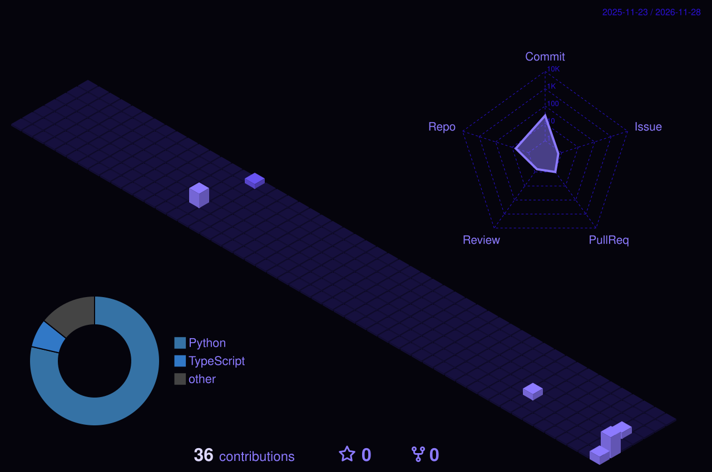

  

  

 

  <picture>
    <source media="(prefers-color-scheme: dark)" srcset="https://raw.githubusercontent.com/balaji87-z/balaji87-z/output/github-contribution-grid-snake-dark.svg" />
    <source media="(prefers-color-scheme: light)" srcset="https://raw.githubusercontent.com/balaji87-z/balaji87-z/output/github-contribution-grid-snake.svg" />
    
  </picture>

 

  

  <a href="mailto:kavinharish07@gmail.com"></a>

  
  
  

  
  

  

  

